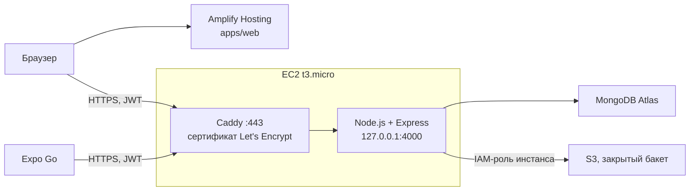

# Публикация в AWS

Как опубликовать проект: веб — в AWS Amplify Hosting, API — на EC2 (t3.micro, Node.js + Express), база — в MongoDB Atlas, файлы задач — в закрытом бакете S3. Мобильное приложение в Expo Go ходит в тот же API.



Почему перед API стоит Caddy с HTTPS: Amplify отдаёт сайт по `https://`, и браузер не даст такой странице обращаться к API по `http://` (mixed content). Своего домена для этого не нужно: имя вида `3-120-45-67.sslip.io` указывает на IP `3.120.45.67`, и Caddy сам получает для него бесплатный сертификат.

Где лежат секреты: строка подключения к Atlas и `JWT_SECRET` — только в `/etc/todo-api.env` на сервере (доступ только root). Ключей AWS нет нигде: доступ к S3 сервер получает через IAM-роль инстанса.

Все шаги ниже — в одном регионе AWS, например `eu-central-1` (Франкфурт). Регион выбирается в правом верхнем углу консоли.

## 1. MongoDB Atlas

1. На [cloud.mongodb.com](https://cloud.mongodb.com) создайте бесплатный кластер **M0**. Провайдер AWS, регион — тот же, что для EC2.
2. **Database Access → Add New Database User**: логин `todo-api`, пароль сгенерируйте, роль **Read and write to any database**.
3. **Network Access → Add IP Address**: сюда позже добавите Elastic IP сервера (шаг 2.4). Пока можно временно добавить `0.0.0.0/0`, а после шага 2.4 заменить его на адрес сервера.
4. **Connect → Drivers** — скопируйте строку подключения и допишите имя базы перед `?`:

   ```
   mongodb+srv://todo-api:<пароль>@cluster0.xxxxx.mongodb.net/todo-app?retryWrites=true&w=majority
   ```

## 2. AWS: S3, IAM-роль, EC2

### 2.1. Бакет S3 для файлов

**S3 → Create bucket**:

- имя — уникальное, например `todo-attachments-<ваш-ник>`;
- **Block all public access** — оставьте включённым (по умолчанию);
- остальное по умолчанию (шифрование SSE-S3 включено).

Bucket policy не нужна: файлы публично не открываются, их отдаёт только API владельцу задачи.

### 2.2. IAM-роль для сервера

1. **IAM → Roles → Create role**: Trusted entity — **AWS service**, Use case — **EC2**. Managed-политики не выбирайте. Имя роли — `todo-api-ec2`.
2. Откройте созданную роль → **Add permissions → Create inline policy → JSON** и вставьте [`deploy/aws/s3-attachments-policy.json`](deploy/aws/s3-attachments-policy.json), заменив `YOUR-BUCKET-NAME` на имя бакета. Роль сможет только класть, читать и удалять объекты в `attachments/` этого бакета.

### 2.3. Сервер EC2

**EC2 → Launch instance**:

| Поле                                    | Значение                                                                                             |
| --------------------------------------- | ---------------------------------------------------------------------------------------------------- |
| Name                                    | `todo-api`                                                                                           |
| AMI                                     | **Ubuntu Server 24.04 LTS** (x86)                                                                    |
| Instance type                           | **t3.micro**                                                                                         |
| Key pair                                | создайте новую и сохраните `.pem` (нужна для SSH; можно обойтись EC2 Instance Connect из браузера)   |
| Network settings → Security group       | новая: **SSH** (22) — My IP; **HTTP** (80) и **HTTPS** (443) — Anywhere. Порт 4000 **не** открывайте |
| Storage                                 | 16 GiB gp3                                                                                           |
| Advanced details → IAM instance profile | `todo-api-ec2`                                                                                       |

### 2.4. Постоянный адрес (Elastic IP)

**EC2 → Elastic IPs → Allocate**, затем **Actions → Associate** с инстансом `todo-api`. Без этого публичный IP меняется после остановки сервера, а с ним и адрес API.

Добавьте этот IP в **Network Access** в Atlas (и уберите `0.0.0.0/0`, если добавляли).

### 2.5. Установка API

Подключитесь к серверу: **EC2 → Instances → todo-api → Connect → EC2 Instance Connect**, или `ssh -i todo-api.pem ubuntu@<Elastic IP>`. Затем:

```bash
curl -fsSL https://raw.githubusercontent.com/offsya/todoListSenama/main/deploy/ec2/setup.sh | sudo bash
```

Скрипт [`deploy/ec2/setup.sh`](deploy/ec2/setup.sh) ставит Node.js 24 и Caddy, клонирует репозиторий в `/opt/todo`, собирает API и создаёт `/etc/todo-api.env` со случайным `JWT_SECRET`. Первый запуск на этом останавливается — впишите настройки:

```bash
sudo nano /etc/todo-api.env
```

- `MONGODB_URI` — строка из шага 1;
- `S3_BUCKET` — имя бакета из шага 2.1 (`AWS_REGION` скрипт уже подставил);
- `CORS_ORIGIN` — адрес сайта Amplify, его заполните после шага 3.

Запустите скрипт ещё раз. Он запустит API как службу systemd `todo-api` (на `127.0.0.1:4000`), настроит Caddy и напечатает адрес вида `https://3-120-45-67.sslip.io`. Проверка:

```bash
curl https://3-120-45-67.sslip.io/health
```

Ответ `{"status":"ok"}` — API работает и подключён к Atlas. Логи: `journalctl -u todo-api -f`.

## 3. Сайт в Amplify Hosting

1. **AWS Amplify → Create new app → GitHub**, разрешите доступ к репозиторию `offsya/todoListSenama`, ветка `main`. Галочку «monorepo» не ставьте: сборку описывает [`amplify.yml`](amplify.yml) в корне.
2. **Advanced settings → Environment variables**: `VITE_API_URL` = адрес API из шага 2.5 (`https://3-120-45-67.sslip.io`).
3. **Save and deploy**. Через пару минут сайт откроется по ссылке вида `https://main.d1a2b3c4d5e6f7.amplifyapp.com`.
4. **Hosting → Rewrites and redirects**: должно быть правило `/<*>` → `/index.html`, тип **404 (Rewrite)** (Amplify обычно создаёт его сам). Без него обновление страницы на `/login` даёт 404.
5. Разрешите сайту обращаться к API — на сервере впишите адрес сайта в `CORS_ORIGIN` и перезапустите службу:

   ```bash
   sudo sed -i 's|^CORS_ORIGIN=.*|CORS_ORIGIN=https://main.d1a2b3c4d5e6f7.amplifyapp.com|' /etc/todo-api.env
   sudo systemctl restart todo-api
   ```

Дальше каждый push в `main` Amplify собирает и публикует сам.

## 4. Мобильное приложение в Expo Go

В `apps/mobile/.env` укажите опубликованный API (не localhost):

```
EXPO_PUBLIC_API_URL=https://3-120-45-67.sslip.io
```

```bash
npm run dev:mobile
```

Отсканируйте QR-код в Expo Go. С компьютера телефон берёт только JS-бандл (одна Wi-Fi-сеть или `npx expo start --tunnel` в `apps/mobile`), а API вызывает напрямую по HTTPS.

## 5. Обновление сервера

После push в `main` на сервере:

```bash
curl -fsSL https://raw.githubusercontent.com/offsya/todoListSenama/main/deploy/ec2/setup.sh | sudo bash
```

Скрипт подтянет код, пересоберёт и перезапустит API; `/etc/todo-api.env` он не трогает.

## Проверка

| Что                                       | Как                                                                                                      |
| ----------------------------------------- | -------------------------------------------------------------------------------------------------------- |
| Сайт открывается по ссылке Amplify        | `https://main.<id>.amplifyapp.com` → регистрация, вход, задачи                                           |
| Вход с телефона через Expo Go             | Expo Go → вход тем же аккаунтом, список тот же, что на сайте                                             |
| Новые задачи появляются в Atlas           | Atlas → **Browse Collections** → `todo-app.todos`                                                        |
| Файл лежит в закрытом S3                  | S3 → бакет → `attachments/<userId>/<todoId>/…`; ссылка **Object URL** в браузере отвечает `AccessDenied` |
| В MongoDB хранится имя файла, а не ссылка | в документе задачи поле `attachment.key` вида `attachments/…`                                            |
| Чужой файл не открывается                 | `GET /todos/<чужой id>/attachment` с другим токеном → `404`                                              |
| Тесты в GitHub Actions                    | вкладка **Actions** → **API tests** → зелёная галочка, в шаге _Run the API tests_ — список тестов        |

## Стоимость и уборка

t3.micro, 30 ГБ диска EBS и Amplify Hosting входят в бесплатный уровень AWS на первые 12 месяцев (или в стартовые кредиты для новых аккаунтов), Atlas M0 бесплатен всегда, файлы в S3 стоят копейки. Отдельно оплачивается публичный IPv4-адрес (около $3.6 в месяц). Когда проект больше не нужен: удалите приложение в Amplify, **Terminate** инстанс, **Release** Elastic IP, очистите и удалите бакет.
