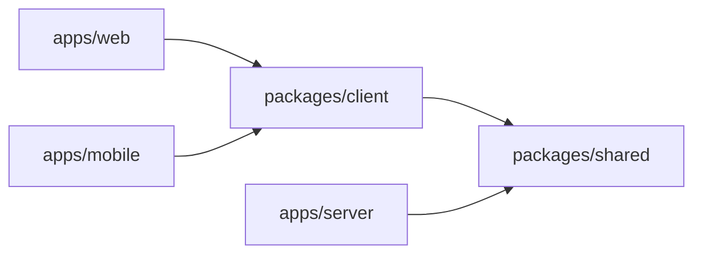

# Todo List

Список задач с регистрацией и входом: REST API, веб-клиент и мобильное приложение в одном монорепозитории.

- **API** — Node.js, Express 5, MongoDB (Mongoose), JWT.
- **Веб** — React 19 + Vite.
- **Мобильное приложение** — Expo (React Native) + Expo Router.

Пользователь регистрируется, входит и работает только со своими задачами: создаёт, редактирует, отмечает выполненными и удаляет их, задаёт срок, прикрепляет файл, фильтрует список и листает его по страницам. Без токена список не открывается, чужие задачи и файлы недоступны — и в API, и в обоих клиентах.

Публикация в AWS (Amplify, EC2, S3, MongoDB Atlas) — в [DEPLOY.md](DEPLOY.md).

## Быстрый старт

Нужен только Docker (на Windows — Docker Desktop). Настраивать ничего не нужно.

```bash
git clone https://github.com/offsya/todoListSenama.git
```

```bash
cd todoListSenama && docker compose up -d --build
```

| Адрес                 | Что там                         |
| --------------------- | ------------------------------- |
| http://localhost:8080 | Веб-клиент                      |
| http://localhost:8082 | Мобильное приложение в браузере |
| http://localhost:4000 | API                             |

Остановить (данные сохранятся):

```bash
docker compose stop
```

## Мобильное приложение на телефоне (Expo Go)

Сначала запустите стек (см. выше). Телефон и компьютер должны быть в одной Wi-Fi-сети.

**Windows** — дважды кликните [`scripts/start-expo.bat`](scripts/start-expo.bat). Скрипт сам найдёт адрес компьютера и покажет QR-код.

**Любая система** — подставьте адрес компьютера в локальной сети:

```bash
EXPO_HOST=192.168.1.10 docker compose --profile expo up expo
```

Отсканируйте QR-код в Expo Go (Android) или камерой (iPhone). В окне работают клавиши Expo: `r` — перезагрузка, `j` — отладчик, `Ctrl+C` — выход. Если телефон не подключается, разрешите в брандмауэре входящие подключения на порты 8081 и 4000.

## Запуск с Docker Hub без исходников

**Windows** — дважды кликните [`scripts/start-todo.bat`](scripts/start-todo.bat).

**Любая система:**

```bash
docker compose -f oci://docker.io/offsya/todolistsenamasoft:compose up -d
```

Expo-сервер для телефона без исходников:

```bash
docker run -it --rm -p 8081:8081 -e REACT_NATIVE_PACKAGER_HOSTNAME=192.168.1.10 offsya/todolistsenamasoft:expo
```

Образы: [offsya/todolistsenamasoft](https://hub.docker.com/r/offsya/todolistsenamasoft) — `:api`, `:web`, `:mobile-web`, `:expo`, а `:latest` — всё в одном контейнере для кнопки **Run** в Docker Desktop (порты 8080, 8082 и 4000 нужно указать в **Optional settings**).

## Команды в Docker

```bash
docker compose logs -f
```

```bash
docker exec -it todoListSenamaSoft-api sh
```

```bash
docker exec -it todoListSenamaSoft-mongo mongosh todo-app
```

Тесты, типы и линтер мобильного приложения:

```bash
docker run --rm offsya/todolistsenamasoft:expo npm test
```

```bash
docker run --rm offsya/todolistsenamasoft:expo npm run typecheck
```

```bash
docker run --rm offsya/todolistsenamasoft:expo npm run lint
```

Проверка всего стека (нужен Node.js):

```bash
npm run smoke
```

Публикация образов (нужен `docker login` с доступом к `offsya`):

```bash
docker compose --profile expo build && docker compose --profile expo push
```

```bash
cd deploy && docker compose publish offsya/todolistsenamasoft:compose
```

```bash
docker build --target all-in-one -t offsya/todolistsenamasoft . && docker push offsya/todolistsenamasoft
```

## Содержание

- [Стек](#стек)
- [Структура репозитория](#структура-репозитория)
- [Публикация в AWS](DEPLOY.md)
- [Локальный запуск для разработки](#локальный-запуск-для-разработки)
- [Мобильное приложение](#мобильное-приложение)
- [API](#api)
- [Тесты](#тесты)
- [Как выполнены требования](#как-выполнены-требования)
- [Архитектурные решения](#архитектурные-решения)
- [Безопасность](#безопасность)
- [Скрипты](#скрипты)
- [Переменные окружения](#переменные-окружения)
- [Процесс разработки](#процесс-разработки)
- [Ограничения и что можно улучшить](#ограничения-и-что-можно-улучшить)

## Стек

| Часть         | Технологии                                                                                                                                       |
| ------------- | ------------------------------------------------------------------------------------------------------------------------------------------------ |
| API           | Node.js 24, Express 5, MongoDB + Mongoose 9, zod 4, jsonwebtoken, scrypt (`node:crypto`), helmet, express-rate-limit, pino, multer, AWS SDK (S3) |
| Веб           | React 19, Vite 8, React Router 7, TanStack Query 5, react-hook-form                                                                              |
| Мобильное     | Expo SDK 57, React Native 0.86, Expo Router, expo-secure-store, DateTimePicker, expo-document-picker, expo-file-system, expo-sharing             |
| Общее         | TypeScript 6, npm workspaces                                                                                                                     |
| Тесты         | Vitest 5, Supertest, mongodb-memory-server, Testing Library, MSW, jest-expo                                                                      |
| Качество кода | ESLint 10 (typescript-eslint с проверкой типов, правила React Compiler), Prettier, GitHub Actions                                                |
| Публикация    | AWS Amplify Hosting (веб), EC2 + systemd + Caddy (API), S3 (файлы), MongoDB Atlas                                                                |

## Структура репозитория

```
apps/
  server/    REST API (Express + MongoDB)
  web/       веб-клиент (React + Vite)
  mobile/    мобильное приложение (Expo)
packages/
  shared/    контракт API: типы, zod-схемы, HTTP-клиент — общий для всех трёх приложений
  client/    общая клиентская логика веба и мобилки: сессия, хуки React Query
```



Одни и те же zod-схемы проверяют запросы на сервере и формы в клиентах, а веб и мобилка используют одинаковые хуки. Приложения отличаются только платформенным UI.

## Локальный запуск для разработки

Нужны **Node.js 24** (см. `.nvmrc`; подойдёт и 22.22+) и npm 10+.

```bash
npm install
```

`npm install` также собирает внутренние пакеты и скачивает бинарник MongoDB для тестов и локального запуска.

```bash
cp apps/server/.env.example apps/server/.env
```

Запустите только MongoDB из Docker:

```bash
docker compose up -d mongo
```

…или без Docker, в отдельном терминале (данные хранятся в `apps/server/.mongo-data`):

```bash
npm run db:memory
```

Запустите API и веб-клиент:

```bash
npm run dev
```

- API — http://localhost:4000
- Веб — http://localhost:5173. Dev-сервер Vite проксирует `/api` на API, поэтому CORS для веба локально не нужен.

Для ручной проверки API есть [`apps/server/requests.http`](apps/server/requests.http) (HTTP Client в WebStorm/IDEA или REST Client в VS Code).

## Мобильное приложение

API должен быть запущен (см. выше). Затем:

```bash
npm run dev:mobile
```

- **Телефон** — откройте QR-код в Expo Go; телефон и компьютер должны быть в одной сети. Адрес API приложение берёт с хоста dev-сервера Expo (тот же компьютер, порт 4000). Брандмауэр должен пропускать входящие подключения на порт 4000.
- **Android-эмулятор** — клавиша `a`; **iOS-симулятор** (macOS) — `i`; **браузер** — `w`.
- **Другой адрес API** (`expo start --tunnel`, другая сеть, задеплоенный API) — задайте его в `apps/mobile/.env`:
  ```
  EXPO_PUBLIC_API_URL=http://192.168.1.10:4000
  ```

Expo Go должен поддерживать SDK 57. Иначе соберите dev-сборку: `npx expo run:android`.

Для релизных и preview-сборок `EXPO_PUBLIC_API_URL` обязателен: без него приложение не запустится, вместо того чтобы молча стучаться на `localhost`. Android в релизных сборках блокирует `http://`, поэтому API должен быть доступен по `https://`.

## API

Базовый адрес — `http://localhost:4000`. Защищённые маршруты требуют заголовок `Authorization: Bearer <token>`.

| Метод  | Путь                    | Описание                                                                          | Ответ                 |
| ------ | ----------------------- | --------------------------------------------------------------------------------- | --------------------- |
| POST   | `/auth/register`        | Регистрация: `{ email, password }`                                                | `201 { token, user }` |
| POST   | `/auth/login`           | Вход: `{ email, password }`                                                       | `200 { token, user }` |
| GET    | `/auth/me`              | Текущий пользователь 🔒                                                           | `200 { user }`        |
| GET    | `/todos`                | Страница задач, новые сверху: `?filter=&page=&limit=` 🔒                          | `200 TodoPage`        |
| POST   | `/todos`                | Создать задачу: `{ text, dueDate? }` 🔒                                           | `201 Todo`            |
| GET    | `/todos/:id`            | Одна задача 🔒                                                                    | `200 Todo`            |
| PUT    | `/todos/:id`            | Изменить текст, статус и/или срок: `{ text?, completed?, dueDate? }` 🔒           | `200 Todo`            |
| DELETE | `/todos/:id`            | Удалить задачу (и её файл) 🔒                                                     | `204`                 |
| POST   | `/todos/:id/attachment` | Прикрепить файл: `multipart/form-data`, поле `file`, до 5 МБ; заменяет прежний 🔒 | `200 Todo`            |
| GET    | `/todos/:id/attachment` | Скачать файл задачи 🔒                                                            | `200` файл            |
| GET    | `/health`               | Живость сервиса и соединение с MongoDB                                            | `200` / `503`         |

```ts
type Todo = {
  id: string;
  text: string;
  completed: boolean;
  dueDate: string | null; // ISO-8601: после этого момента невыполненная задача просрочена
  attachment: { name: string; size: number; contentType: string } | null;
  createdAt: string;
  updatedAt: string;
};
type TodoPage = { items: Todo[]; page: number; limit: number; total: number; totalPages: number };
type User = { id: string; email: string; createdAt: string };
```

**Фильтр и страницы.** `GET /todos` принимает `filter`, `page` и `limit`. По умолчанию `filter=all`, `page=1`, `limit=10` (`limit` — до 100).

| `filter`  | Какие задачи                                     |
| --------- | ------------------------------------------------ |
| `all`     | все                                              |
| `active`  | невыполненные, срок ещё не вышел (или срока нет) |
| `done`    | выполненные                                      |
| `overdue` | невыполненные, срок уже вышел                    |

В клиентах срок выбирается как день и сохраняется как конец этого дня в часовом поясе пользователя: задача «на сегодня» становится просроченной только после полуночи.

**Файлы.** У задачи может быть один файл. Он хранится в закрытом бакете S3 под случайным ключом `attachments/<userId>/<todoId>/<uuid>`; в MongoDB лежит этот ключ, а не ссылка. Наружу ключ не отдаётся: файл можно получить только через `GET /todos/:id/attachment` с токеном владельца, остальные получают тот же ответ, что и для несуществующей задачи (`404`). Новый файл заменяет прежний, удаление задачи удаляет и файл. Без `S3_BUCKET` маршруты файлов отвечают `503`.

Правила валидации (общие для сервера и клиентов, [`packages/shared/src/schemas`](packages/shared/src/schemas)):

- email обрезается по краям и приводится к нижнему регистру, до 254 символов;
- пароль от 8 до 128 символов;
- текст задачи от 1 до 500 символов после обрезки пробелов;
- срок — дата и время ISO-8601 с часовым поясом (`2030-05-01T23:59:59+03:00`) или `null`;
- неизвестные поля отклоняются, поэтому, например, сменить владельца задачи через API нельзя.

Кроме того, у одного пользователя может быть не больше 1000 задач: страницы читаются через skip/limit, и лимит держит дешёвой даже последнюю.

Все ошибки возвращаются в одном формате:

```json
{
  "error": {
    "code": "VALIDATION_ERROR",
    "message": "Validation failed",
    "details": [{ "path": "text", "message": "Text must not be empty" }]
  }
}
```

| Статус | `code`                            | Когда                                                                                                            |
| ------ | --------------------------------- | ---------------------------------------------------------------------------------------------------------------- |
| 400    | `VALIDATION_ERROR`, `BAD_REQUEST` | Невалидное тело или id, битый JSON, некорректный запрос                                                          |
| 401    | `UNAUTHORIZED`                    | Нет токена, токен невалиден или истёк, неверный пароль                                                           |
| 404    | `NOT_FOUND`                       | Задачи нет **или она принадлежит другому пользователю**                                                          |
| 409    | `CONFLICT`                        | Email уже зарегистрирован; у пользователя уже 1000 задач                                                         |
| 413    | `PAYLOAD_TOO_LARGE`               | Тело запроса больше 10 КБ, файл больше 5 МБ                                                                      |
| 415    | `BAD_REQUEST`                     | Неподдерживаемые `Content-Encoding` или кодировка тела                                                           |
| 429    | `TOO_MANY_REQUESTS`               | Слишком много попыток входа или регистрации с одного IP, слишком много запросов к задачам от одного пользователя |
| 500    | `INTERNAL_ERROR`                  | Непредвиденная ошибка (подробности только в логах)                                                               |
| 503    | `SERVICE_UNAVAILABLE`             | Хранилище файлов не настроено (`S3_BUCKET`)                                                                      |

## Тесты

```bash
npm test
```

Только тесты API (их же запускает GitHub Actions):

```bash
npm run test:api
```

| Пакет             | Что проверяется                                                                                                                       | Тестов |
| ----------------- | ------------------------------------------------------------------------------------------------------------------------------------- | -----: |
| `apps/server`     | API целиком через Supertest на MongoDB: авторизация, чужие задачи и файлы, фильтры, страницы, сроки, файлы, валидация, ошибки, лимиты |    140 |
| `apps/web`        | Приложение целиком (маршруты, guards, фильтры, страницы, файлы, истечение токена, фокус с клавиатуры) с Testing Library и MSW         |     37 |
| `apps/mobile`     | Компоненты, навигация, CRUD, фильтры и страницы на реальных маршрутах Expo Router, холодный старт, истёкший токен (jest-expo)         |     37 |
| `packages/client` | Хранилище сессии, страницы и фильтры, оптимистичные обновления и откаты, смена аккаунта во время запросов, сроки, редактор            |     58 |
| `packages/shared` | Схемы валидации и HTTP-клиент, включая загрузку и скачивание файлов                                                                   |     53 |

Тесты API из третьего этапа задания:

| Требование                       | Где                                                                                                                                                                             |
| -------------------------------- | ------------------------------------------------------------------------------------------------------------------------------------------------------------------------------- |
| Успешный логин                   | [`auth.test.ts`](apps/server/test/auth.test.ts) — `POST /auth/login › returns a valid access token for correct credentials`                                                     |
| Чужая задача недоступна          | [`authorization.test.ts`](apps/server/test/authorization.test.ts) — `access to other users' todos` (чтение, изменение, удаление, список)                                        |
| Невалидные данные                | [`todos.test.ts`](apps/server/test/todos.test.ts), [`auth.test.ts`](apps/server/test/auth.test.ts) — `rejects …`; [`app.test.ts`](apps/server/test/app.test.ts) — битые запросы |
| Без токена список не открывается | [`authorization.test.ts`](apps/server/test/authorization.test.ts) — `requires a token`, просроченный и поддельный токены                                                        |

Каждый тестовый файл API работает в своей базе, поэтому файлы выполняются параллельно. Локально базы создаются в одном экземпляре mongodb-memory-server. Если задана `TEST_MONGODB_URI`, тесты берут эту MongoDB: так их на каждый push запускает [`.github/workflows/api-tests.yml`](.github/workflows/api-tests.yml) — той же командой `npm run test:api` и со своим контейнером `mongo:8` (не Atlas, не EC2 и не Amplify). Файлы в тестах хранятся в памяти вместо S3.

## Как выполнены требования

**1. Задачи.** Эндпоинты `GET/POST /todos`, `PUT/DELETE /todos/:id` (плюс `GET /todos/:id`), данные хранятся в MongoDB. В вебе и в мобильном приложении задачи можно создавать, редактировать (двойной клик или карандаш в вебе, тап по тексту в мобилке), отмечать выполненными, удалять и фильтровать.

**2. Пользователи.** `POST /auth/register` и `POST /auth/login` возвращают JWT. Каждая задача хранит владельца, и все запросы к задачам ограничены владельцем из токена. В вебе маршруты закрыты guard'ами, в мобилке — `Stack.Protected`. Истёкший или отозванный токен разлогинивает пользователя автоматически.

**3. Тесты API.** См. [таблицу выше](#тесты). Помимо API, тестами покрыты общие пакеты, веб и мобилка.

**4. Публикация.** Сайт собирает AWS Amplify Hosting по [`amplify.yml`](amplify.yml), адрес API передаётся в переменной `VITE_API_URL`. API работает на EC2 t3.micro как служба systemd под Node.js; [`deploy/ec2/setup.sh`](deploy/ec2/setup.sh) ставит его вместе с Caddy (HTTPS). Строка подключения к Atlas и `JWT_SECRET` лежат в `/etc/todo-api.env` на сервере, доступ к S3 даёт IAM-роль инстанса, в коде секретов нет. Мобильное приложение получает адрес API из `EXPO_PUBLIC_API_URL`. Пошагово — в [DEPLOY.md](DEPLOY.md).

**5. Автозапуск тестов.** [`.github/workflows/api-tests.yml`](.github/workflows/api-tests.yml) на каждый push запускает `npm run test:api` со своим сервисом `mongo:8`; reporter `verbose` выводит в журнал каждый тест.

**6. Файл у задачи.** `POST` и `GET /todos/:id/attachment`, закрытый бакет S3, в MongoDB — ключ объекта. Загрузить и скачать файл может только владелец. Веб скачивает файл с токеном и сохраняет его, мобилка скачивает в кэш и открывает системное меню «Поделиться / Открыть в».

**7. Срок и фильтр.** Поле `dueDate`, фильтры `all`, `active`, `done` и `overdue` считаются на сервере. В обоих клиентах есть выбор даты (в вебе поле даты, в мобилке системный DateTimePicker), отметка просроченных задач и те же четыре фильтра.

**8. Страницы.** `page` и `limit` (по умолчанию 1 и 10), в обоих клиентах кнопки «‹ Previous» и «Next ›» с номером страницы. Если удалена последняя задача страницы, клиент переходит на предыдущую.

**9. Выход.** Кнопка Sign out удаляет сохранённый JWT (localStorage в вебе, Keychain/Keystore в мобилке) и открывает экран входа. Токен действует 15 минут. Ответ 401 на любой запрос сбрасывает сессию и открывает экран входа, без вечной загрузки: это проверяют тесты с токеном, истёкшим к открытию приложения и во время работы со списком.

## Архитектурные решения

- **Монорепозиторий на npm workspaces.** Внутренние пакеты собираются в ESM (`dist/`), и Node, Vite и Metro потребляют один и тот же JS. Корневые скрипты собирают их в порядке зависимостей, а `test`/`typecheck`/`lint` перед запуском пересобирают пакеты, поэтому никогда не работают с устаревшим `dist`.
- **Контракт в одном месте.** zod-схемы из `@todo/shared` валидируют запросы на сервере и формы в клиентах, так что ограничения не расходятся. Типизированный HTTP-клиент общий для веба и мобилки.
- **Слои сервера:** `router → controller → service → model`. Ответы собираются явными DTO-мапперами, поэтому служебные поля (`owner`, хеш пароля) не утекают. Ошибки обрабатываются в одном месте.
- **`404` вместо `403` для чужой задачи** — по ответу нельзя проверить, существует ли задача с таким id.
- **`PUT` — частичное обновление** (текст и/или статус), как сформулировано в задании.
- **Пароли хешируются scrypt из `node:crypto`** (N=2¹⁵, r=8, p=3 по рекомендации OWASP). Вычисление идёт в пуле потоков libuv и не блокирует event loop. Первая версия использовала bcryptjs — чистый JS в основном потоке, и на ревью замер показал, что 15 параллельных логинов замедляли весь API до ~0,6 с на запрос; со scrypt ответ остаётся ~15 мс.
- **Оптимистичные обновления** (TanStack Query): интерфейс реагирует сразу. При ошибке откатывается только то, что изменил неудачный запрос, а после последней из параллельных мутаций список синхронизируется с сервером. Кеш разделён по пользователям и очищается при смене пользователя.
- **Одна версия React во всём репозитории.** Expo SDK 57 фиксирует React 19.2.3, поэтому веб использует ту же версию. По той же причине веб на React Router 7: v8 требует React ≥ 19.2.7, а две копии React в монорепозитории ломают хуки.
- **Токен на клиентах.** В вебе он лежит в `localStorage`, сессия синхронизируется между вкладками. Это просто и переживает перезагрузку, но токен доступен скриптам на странице — защита держится на отсутствии XSS (React экранирует вывод), а в Docker-образе её дополняет строгая Content-Security-Policy. Альтернатива — httpOnly-cookie, но тогда понадобится защита от CSRF. В мобилке токен хранится в Keychain/Keystore через `expo-secure-store`.

## Безопасность

- JWT HS256: алгоритм зафиксирован при подписи и проверке, `sub` проверяется как ObjectId, срок жизни настраивается (по умолчанию 15 минут).
- На неизвестный email и неверный пароль вход отвечает одинаково и тратит одинаковое время (сравнение с фиктивным хешем), поэтому по входу нельзя узнать, зарегистрирован ли email. Регистрация при этом честно отвечает 409 на занятый email: без подтверждения почты это осознанный компромисс.
- Попытки входа и регистрации ограничены по IP (`AUTH_RATE_LIMIT_MAX`). За прокси нужно задать `TRUST_PROXY`, а сам API не должен быть доступен в обход прокси (в Docker так и сделано).
- Запросы к задачам ограничены по пользователю (`TODOS_RATE_LIMIT_MAX`), а список — 1000 задачами: один аккаунт не может завалить базу записями или раздуть ответ `GET /todos`.
- Строгие схемы отклоняют лишние поля (mass assignment), а Mongoose `sanitizeFilter` даёт дополнительную защиту от NoSQL-инъекций.
- helmet, CORS по allow-list, лимит тела 10 КБ, `WWW-Authenticate` на ответах 401.
- Заголовки и токены не попадают в логи. Текст ошибок 500 не раскрывает внутренности.
- В production API не запустится с примером `JWT_SECRET` из `.env.example`.
- Файлы задач лежат в закрытом бакете S3, без публичных ссылок. API отдаёт их только владельцу и всегда с `Content-Disposition: attachment`, поэтому загруженный HTML не откроется как страница. Имя файла очищается от путей и управляющих символов. Сервер на EC2 получает доступ к бакету через IAM-роль с правами только на `attachments/*`.

## Скрипты

| Команда              | Что делает                                             |
| -------------------- | ------------------------------------------------------ |
| `npm run dev`        | API + веб + пересборка общих пакетов в watch-режиме    |
| `npm run dev:server` | Только API                                             |
| `npm run dev:web`    | Только веб                                             |
| `npm run dev:mobile` | Expo dev-сервер                                        |
| `npm run db:memory`  | Локальная MongoDB без Docker                           |
| `npm test`           | Все тесты                                              |
| `npm run test:api`   | Тесты API (как в GitHub Actions)                       |
| `npm run lint`       | ESLint по всему репозиторию                            |
| `npm run typecheck`  | Проверка типов во всех пакетах                         |
| `npm run build`      | Сборка API и веба, Android-бандл мобильного приложения |
| `npm run smoke`      | Проверка запущенного Docker-стека                      |
| `npm run format`     | Prettier                                               |

## Переменные окружения

**API** (`apps/server/.env`, пример — [`.env.example`](apps/server/.env.example)):

| Переменная             | По умолчанию                                  | Назначение                                          |
| ---------------------- | --------------------------------------------- | --------------------------------------------------- |
| `PORT`                 | `4000`                                        | Порт API                                            |
| `MONGODB_URI`          | `mongodb://127.0.0.1:27017/todo-app`          | Строка подключения к MongoDB                        |
| `JWT_SECRET`           | — (обязательна)                               | Секрет подписи токенов, минимум 32 символа          |
| `JWT_EXPIRES_IN`       | `15m`                                         | Срок жизни токена: `15m`, `12h`, `7d`…              |
| `CORS_ORIGIN`          | `http://localhost:5173,http://localhost:8081` | Разрешённые origin браузерных клиентов              |
| `LOG_LEVEL`            | `info`                                        | Уровень логов pino                                  |
| `PASSWORD_HASH_COST`   | `15`                                          | log₂ N для scrypt                                   |
| `AUTH_RATE_LIMIT_MAX`  | `20`                                          | Попыток входа/регистрации с одного IP за 15 минут   |
| `TODOS_RATE_LIMIT_MAX` | `300`                                         | Запросов к `/todos` от одного пользователя в минуту |
| `TRUST_PROXY`          | `0`                                           | Число обратных прокси перед API                     |
| `HOST`                 | все интерфейсы                                | Адрес, на котором слушать (`127.0.0.1` за Caddy)    |
| `S3_BUCKET`            | —                                             | Закрытый бакет S3 для файлов задач                  |
| `AWS_REGION`           | —                                             | Регион бакета (обязателен вместе с `S3_BUCKET`)     |
| `TEST_MONGODB_URI`     | —                                             | MongoDB для `npm run test:api` вместо базы в памяти |

**Веб** (`apps/web/.env`): `VITE_API_URL` — адрес API (по умолчанию `/api` через dev-прокси); `API_PROXY_TARGET` — куда проксировать `/api` (по умолчанию `http://localhost:4000`).

**Мобильное** (`apps/mobile/.env`): `EXPO_PUBLIC_API_URL` — адрес API. В разработке по умолчанию берётся хост dev-сервера Expo с портом 4000; для релизных сборок переменная обязательна.

## Процесс разработки

- Работа шла по этапам задания, в feature-ветках с merge-коммитами: `feature/todos-api` → `feature/auth` → `feature/web` → `feature/mobile` → `chore/ci-docs` → `feature/docker` → `fix/review-findings`. Сообщения коммитов следуют Conventional Commits.
- Каждая ветка с кодом (API, веб, мобилка) перед слиянием проходила независимое код-ревью. Найденные проблемы исправлены отдельными коммитами `fix: address review feedback…` с описанием, что и почему изменено. В их числе: блокирующее event loop хеширование паролей, ответы 500 на некорректные запросы, гонки оптимистичных обновлений, утечка нажатия Enter в кнопку редактирования, дубли задач при повторном нажатии return на клавиатуре телефона.
- Перед сдачей весь репозиторий прошёл финальное ревью: [CODE_REVIEW.md](CODE_REVIEW.md) — что и как проверялось, что найдено и как исправлено (ветка `fix/review-findings`).
- Тесты API на каждый push запускает отдельный workflow `API tests` со своей MongoDB (`mongo:8` как service container).
- CI (GitHub Actions) на Node 22 и 24 проверяет форматирование, линт, типы и тесты, собирает API и веб и проверяет, что Metro собирает Android-бандл мобильного приложения. Отдельная задача собирает Docker-стек, ждёт, пока все контейнеры станут healthy, и прогоняет по нему `npm run smoke`.

## Ограничения и что можно улучшить

- Нет refresh-токенов и отзыва токена на сервере: выход — локальный, а через 15 минут нужно войти заново. Для веба можно перейти на httpOnly-cookie и refresh-токены.
- Страницы читаются через skip/limit, поэтому список ограничен 1000 задачами. Если лимит понадобится поднять, нужна курсорная пагинация.
- В Docker-стеке нет S3, поэтому прикрепление файлов там отвечает `503`. Чтобы проверить файлы локально, задайте `S3_BUCKET`, `AWS_REGION` и ключи AWS в окружении API.
- Счётчики rate limit хранятся в памяти процесса. Для нескольких экземпляров API нужно общее хранилище (Redis).
- E2E-тесты в настоящих браузере и устройстве (Playwright, Maestro).
- Офлайн-режим и очередь изменений в мобильном приложении.
- Интерфейс только на английском, без i18n: кнопки называются Sign out, Previous и Next, а не «Выйти», «назад» и «дальше».
- `npm audit` находит уязвимости в транзитивных зависимостях CLI-инструментов Expo (braces, node-forge, uuid, decode-uri-component). Это инструменты разработки, они не попадают ни в API, ни в собранные приложения; обновить их можно только вместе с SDK.
